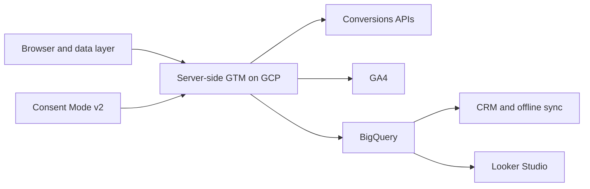
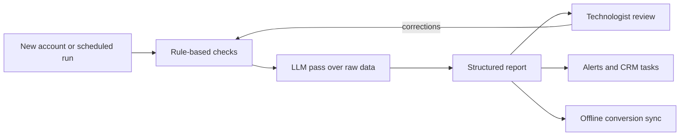

  <picture>
    <source media="(prefers-color-scheme: dark)" srcset="assets/banner-dark.svg">
    
  </picture>

  <a href="https://felixkaboto.dev">Portfolio</a> &middot;
  <a href="https://felixkaboto.dev/case-studies">Case studies</a> &middot;
  <a href="https://www.linkedin.com/in/felix-kaboto">LinkedIn</a> &middot;
  <a href="https://x.com/FelixKaboto">X</a> &middot;
  <a href="mailto:felixkaboto@gmail.com">Email</a>

  
  
  
  
  

---

> I work on the systems a business runs on, from the site that turns a visitor into a lead, to the tracking that proves the lead was worth having, to the agent that audits all of it while I sleep. Some engagements are a rebuild, some are a migration, some are a custom agent that removes a weekly chore, and some are a strategy session that ends with a roadmap and nobody touching a server.

---

## How the pieces connect

Events leave the browser once, pass through a controlled server-side container, then fan out to ad platforms, analytics, and a warehouse. Consent state travels with them, so every destination only receives what it is allowed to.

---

## Five lanes

Each engagement starts in one lane and often pulls in a second. The list is deliberately distinct: no lane is a reworded version of another.

| Lane | What the work looks like | What it changes |
| --- | --- | --- |
| **Measurement engineering** | Server-side tracking on GCP, first-party routing, Conversions APIs, consent configuration, warehouse pipelines | Ad platforms see the conversions that actually happened, and the numbers survive scrutiny |
| **Web development** | Next.js and React builds, WordPress and PHP sites, performance work, technical SEO, booking and form flows | Pages load fast, structure stays crawlable, and forms hand clean data to the systems behind them |
| **RevOps** | CRM architecture, lifecycle stages, lead routing, data hygiene rules, offline conversion joins, revenue reporting | Sales and marketing argue about pipeline instead of arguing about whose numbers are right |
| **AI and automation** | Custom agents for audit, triage, and monitoring; n8n and Zapier workflows; LLM pipelines wired to real APIs | Repetitive work runs on a schedule instead of on someone's calendar, with a human still signing off |
| **Consulting** | Discovery, tracking and process audits, roadmap and requirements work, standards ownership, team training | A written plan with priorities, owners, and a way to tell whether it worked |

---

## Selected work

| Sector | Lane | Problem | What I did | Result |
| --- | --- | --- | --- | --- |
| Mid-market e-commerce and lead generation | Measurement | 15 to 30 percent of conversions vanished from ad platforms after privacy changes, while the conversions were still happening | Moved delivery server-side on GCP, routed first-party events through custom subdomains, wired cross-platform Conversions APIs, layered Advanced Consent Mode v2 | 15 to 30 percent of lost conversions recovered per client, with more accurate ROAS reporting |
| Enterprise accounts at a US digital agency | AI, automation | Onboarding audits took three days of senior time and still missed gaps that surfaced weeks later | Broke audits into repeatable checks, ran each through an LLM pipeline with focused prompts and raw API data, required technologist sign-off | Audit cycle cut from 3 days to 2 days, and gaps manual review kept missing are now caught |
| Internal tooling at a US digital agency | AI, automation | Manual triage ate senior hours weekly, and broken tracking surfaced only when a client noticed a reporting gap | Built an n8n prioritization agent and a monitoring agent that watches event volume and conversion streams against tuned thresholds | Roughly 20 hours a month saved, and silent data loss caught before it reaches a report |
| A coaching business | Web | Site could take bookings but ranked poorly, loaded slowly, and gave the team no confidence in on-page structure | Rebuilt templates, tightened performance and technical SEO, restructured the booking path and content hierarchy | 40 percent more client bookings, and a site the owner can update without a developer |
| An African fintech remittance company | Marketing, RevOps | Needed growth across paid, organic, and creator channels with no way to see channel-level return | Ran acquisition and lifecycle campaigns, built a UTM and event framework that measured creator ROI, aligned lifecycle stages with the CRM | Audience grew from 45K to 100K followers, 122 percent, with channel ROI visible for the first time |

Full write-ups, including the stack and the mistakes, live at **[felixkaboto.dev/case-studies](https://felixkaboto.dev/case-studies)**.

---

## Impact

| Metric | Value | What it means |
| --- | --- | --- |
| Conversions recovered | 15 to 30% | Lost tracking restored through server-side migrations |
| Audit speed | ~33% faster | Agent cut audits from 3 days to 2 days |
| Triage saved | ~20 hrs/month | Prioritization agent replaced manual work ranking |
| Bookings | +40% | Rebuild plus technical SEO on a booking-led site |
| Client accounts | 100+ | End-to-end analytics and web engagements |
| Experience | 7+ years | Measurement, web, marketing, and technical leadership |

---

## AI, automation, and custom agents

The agents handle work that is repetitive, checkable, and easy to get subtly wrong. They do not replace judgment on the review side.

**Custom agents I have built**

| Agent | What it reads | What it produces | Guardrail |
| --- | --- | --- | --- |
| Audit agent | GA4, GTM, and platform configuration plus raw API data | Structured findings report with severity, reviewed before client delivery | Rule-based checks run first; a technologist signs off every output |
| Prioritization agent | The incoming request queue and account context | Ranked worklist with a stated reason per item | Anyone can override a ranking; the agent never assigns work on its own |
| Monitoring agent | Event volume, conversion streams, consent state | Drop alerts and broken-tracking flags before a client notices | Thresholds tuned against real incidents and reviewed monthly |

**Automation around them**

- Offline conversion sync from CRM back to ad platforms on a schedule.
- Lead routing and data hygiene rules that keep CRM records usable.
- Scheduled audit runs with reports delivered where the team already works.
- Looker Studio refreshes with alerting when a source goes quiet.
- Webhook glue between tools that have no native integration.

**How they are bounded**

Rule-based checks run before any model sees data. The model reads raw API output and drafts a report; it never writes to a production container. Every output gets human sign-off before it reaches a client. I tuned precision against real false positives for about a month before the team trusted the output, and the first version with too many checks at once was worse than the manual process it replaced.

> Audits used to take three days of senior time. The agent runs the checks, drafts the report, and a technologist reviews it in two hours. It also catches coverage gaps that manual review kept missing.

---

## Current focus

- Building a reusable server-side GTM template library so migrations stop being one-off builds.
- Turning the audit agent into a toolkit other technologists can run without my involvement.
- Moving attribution out of spreadsheets and into BigQuery-first joins.

---

## Web work and side builds

Freelance and personal builds, described by function rather than name.

| Build | What it involved |
| --- | --- |
| A revenue marketing agency site | Multi-service marketing site with CAPI, CRM integrations, and analytics wired in from the start |
| A pre-launch diaspora community platform | Community platform with content pillars and early access capture, 500+ sign-ups before launch |
| Small business site rebuilds | WordPress and Next.js rebuilds with technical SEO, performance work, and measurement designed in from the first commit |

---

## What I work with

<strong>Measurement and cloud</strong>

- Server-Side GTM on Google Cloud Platform
- GA4, Google Tag Manager, data layer frameworks
- Conversions APIs and Enhanced Conversions
- Custom ecommerce, cross-domain, and multi-domain tracking
- App analytics and mobile measurement partners
- Custom JavaScript event listeners

<strong>Web development</strong>

- Next.js, React, TypeScript
- WordPress, PHP, Tailwind CSS
- Technical SEO, Core Web Vitals, structured data
- Booking, form, and payment flows
- Accessibility and responsive layout

<strong>AI and automation</strong>

- Custom agents for audit, triage, and monitoring
- LLM pipelines with focused prompts over real API data
- n8n and Zapier workflow automation
- REST APIs and custom webhooks
- Automated monitoring and alerting

<strong>Data and RevOps</strong>

- BigQuery, SQL, ELT pipelines
- Salesforce, HubSpot, Marketo: CRM architecture and lifecycle stages
- Lead routing, data hygiene rules, offline conversion sync
- Identity matching and attribution modelling
- Looker Studio dashboards for revenue reporting

<strong>Privacy engineering</strong>

- Advanced Consent Mode v2
- GDPR and POPIA aligned setups
- Consent management platform integration
- First-party data strategy

<strong>Marketing and consulting</strong>

- SEO, PPC, and paid social
- Email automation and list segmentation
- Discovery, requirements, and solution architecture
- Tracking and process audits with written findings
- Roadmaps, standards, and documentation systems
- Mentoring and team enablement

---

## Background

Seven years across web development, MarTech, digital marketing, and revenue operations. Started building sites, moved into measurement and marketing systems, and now lead analytics engagements for enterprise clients at a US digital agency while taking on web, automation, and consulting work directly. Fully remote from South Africa for four years, overlapping Cape Town mornings with US East Coast hours. I mentor four technologists and own the technical standards for tracking and data quality.

**Certifications:** Google Analytics Individual Qualification, Advanced Google Analytics, Google Ads, Looker Studio, HubSpot Data Integrations, Meta Social Media Marketing Professional.

---

## Let's talk

Four things I get asked about most: a rebuild, a migration, a process nobody trusts, or a repetitive job that should have been automated last year. Fastest route is my portfolio: **[felixkaboto.dev](https://felixkaboto.dev)**

Or reach me directly at [felixkaboto@gmail.com](mailto:felixkaboto@gmail.com), or on [LinkedIn](https://www.linkedin.com/in/felix-kaboto).

Last updated October 2026

