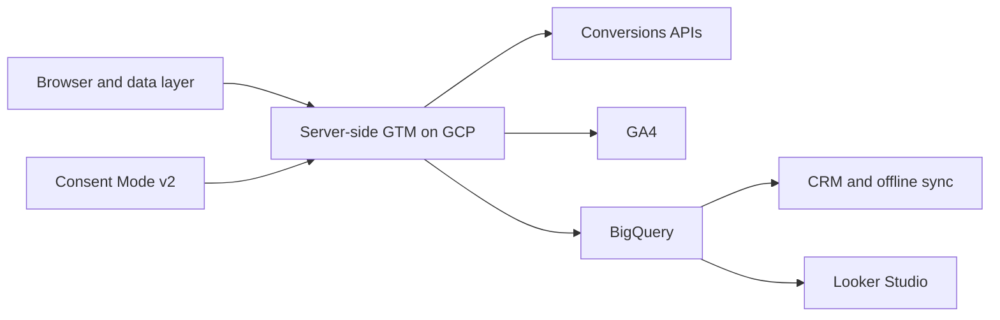
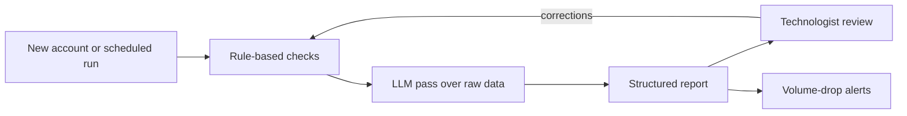

  <picture>
    <source media="(prefers-color-scheme: dark)" srcset="assets/banner-dark.svg">
    
  </picture>

  <a href="https://felixkaboto.dev">Portfolio</a> &middot;
  <a href="https://www.linkedin.com/in/felix-kaboto">LinkedIn</a> &middot;
  <a href="https://x.com/FelixKaboto">X</a> &middot;
  <a href="mailto:felixkaboto@gmail.com">Email</a>

  
  
  
  
  

---

> I build the measurement layer underneath marketing decisions: server-side tracking that recovers conversions ad platforms lose, warehouse pipelines that make attribution auditable, and AI agents that run tracking audits in hours instead of days. Most of my work sits where privacy rules, ad platforms, and CRM data stop agreeing with each other.

---

## How the pieces connect

Events leave the browser once, pass through a controlled server-side container, then fan out to ad platforms, analytics, and a warehouse. Consent state travels with them, so every destination only receives what it is allowed to.

---

## Selected work

| Sector | Problem | What I did | Result |
| --- | --- | --- | --- |
| Mid-market e-commerce and lead generation | 15 to 30 percent of conversions vanished from ad platforms after privacy changes, while the conversions were still happening | Moved delivery server-side on GCP, routed first-party events through custom subdomains, wired cross-platform Conversions APIs, layered Advanced Consent Mode v2, added data-quality checks | 15 to 30 percent of lost conversions recovered per client, with more accurate ROAS reporting |
| Enterprise accounts at a US digital agency | Onboarding audits took three days of senior time and still missed gaps that surfaced weeks later | Broke audits into repeatable checks, ran each one through an LLM pipeline with focused prompts and raw API data, produced structured reports for technologist review | Audit cycle cut from 3 days to 2 days, and gaps manual review kept missing are now caught |
| An African fintech remittance company | Needed social growth across paid, organic, and creator channels with no way to see channel-level return | Ran acquisition and lifecycle campaigns, built a UTM and event framework that measured creator ROI, coordinated on-the-ground content, protected brand accounts | Audience grew from 45K to 100K followers, 122 percent, with channel ROI visible for the first time |

---

## Impact

| Metric | Value | What it means |
| --- | --- | --- |
| Conversions recovered | 15 to 30% | Lost tracking restored through server-side migrations |
| Audit speed | ~33% faster | Agent cut audits from 3 days to 2 days |
| Client accounts | 100+ | End-to-end analytics engagements |
| Experience | 7+ years | MarTech, data pipelines, and technical leadership |

---

## AI systems I build

The agents handle work that is repetitive, checkable, and easy to get subtly wrong. They do not replace judgment on the review side.

**What they do**

- Audit tracking setups across GA4, GTM, and platform configuration: naming, event coverage, consent state, data-layer integrity, cross-domain behaviour, conversion firing.
- Triage incoming work and replace manual prioritization, saving roughly 20 hours a month.
- Watch event volume and flag drops or broken tracking before a client notices a gap in reporting.

**How they are bounded**

Rule-based checks run before any model sees data. The model reads raw API output and drafts a report; it never writes to a production container. Every output gets human sign-off before it reaches a client. I tuned precision against real false positives for about a month before the team trusted the output, and the first version with too many checks at once was worse than the manual process it replaced.

> Audits used to take three days of senior time. The agent runs the checks, drafts the report, and a technologist reviews it in two hours. It also catches coverage gaps that manual review kept missing.

---

## Current focus

- Building a reusable server-side GTM template library so migrations stop being one-off builds.
- Widening the audit agent beyond precision work into something the team trusts without re-reading every line.
- Moving attribution out of spreadsheets and into BigQuery-first joins.

---

## What I work with

<strong>Server-side and cloud analytics</strong>

- Server-Side GTM on Google Cloud Platform
- GA4, Google Tag Manager, data layer frameworks
- Conversions APIs and Enhanced Conversions
- Custom ecommerce, cross-domain, and multi-domain tracking
- App analytics and mobile measurement partners

<strong>Data and pipelines</strong>

- BigQuery, SQL, ELT pipelines
- Identity matching and attribution modelling
- Offline conversion sync and CRM joins
- Looker Studio dashboards

<strong>Automation and AI</strong>

- n8n and Zapier workflow automation
- LLM-powered audit and triage pipelines
- REST APIs and custom webhooks
- Automated monitoring and alerting

<strong>Privacy engineering</strong>

- Advanced Consent Mode v2
- GDPR and POPIA aligned setups
- Consent management platform integration
- First-party data strategy

<strong>Languages and platforms</strong>

- JavaScript, Python, SQL, PHP, HTML and CSS
- Salesforce, HubSpot, Marketo
- WordPress, GitHub

---

## Background

Seven years across MarTech, web development, and digital marketing. Currently leading analytics engagements for enterprise clients at a US digital agency, fully remote from South Africa for four years, overlapping Cape Town mornings with US East Coast hours. I mentor four technologists and own the technical standards for tracking and data quality.

**Certifications:** Google Analytics Individual Qualification, Advanced Google Analytics, Google Ads, Looker Studio, HubSpot Data Integrations, Meta Social Media Marketing Professional.

---

## Let's talk

If you are dealing with a tracking migration, an attribution gap, or a consent setup that needs to survive an audit, the fastest route is my portfolio: **[felixkaboto.dev](https://felixkaboto.dev)**

Or reach me directly at [felixkaboto@gmail.com](mailto:felixkaboto@gmail.com), or on [LinkedIn](https://www.linkedin.com/in/felix-kaboto).

Last updated October 2026

