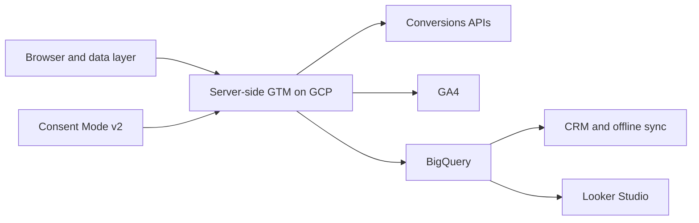
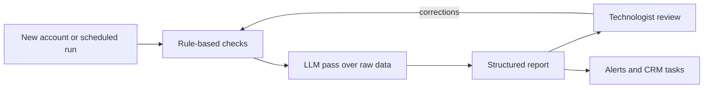

  <picture>
    <source media="(prefers-color-scheme: dark)" srcset="assets/banner-dark.svg">
    
  </picture>

  <a href="https://felixkaboto.dev">Portfolio</a> &nbsp;&middot;&nbsp;
  <a href="https://felixkaboto.dev/case-studies">Case studies</a> &nbsp;&middot;&nbsp;
  <a href="https://felixkaboto.dev/assets/felix-kaboto-cv.pdf">CV</a> &nbsp;&middot;&nbsp;
  <a href="https://www.linkedin.com/in/felix-kaboto">LinkedIn</a> &nbsp;&middot;&nbsp;
  <a href="mailto:felixkayz001@gmail.com">Email</a>

> I work on the systems a business runs on, from the site that turns a visitor into a lead, to the tracking that proves the lead was worth having, to the agent that audits all of it while I sleep.

  <strong>7+ years</strong> across measurement, web, and RevOps &nbsp;&middot;&nbsp; <strong>100+</strong> client accounts &nbsp;&middot;&nbsp; <strong>15 to 30%</strong> of lost conversions recovered &nbsp;&middot;&nbsp; audits cut from <strong>3 days to 2</strong>

  
  
  
  
  

  <a href="#work">Work</a> &nbsp;&middot;&nbsp; <a href="#capabilities">Capabilities</a> &nbsp;&middot;&nbsp; <a href="#profile">Profile</a> &nbsp;&middot;&nbsp; <a href="#lets-talk">Contact</a>

## Work

<strong>Selected work</strong> &nbsp;four engagements

| Work | What I did | Result |
| :--- | :--- | ---: |
| **[Recovering lost conversions](https://felixkaboto.dev/case-studies/server-side-tracking-migration)** E-commerce and lead generation | Moved delivery server-side on GCP with first-party routing and cross-platform Conversions APIs | 15 to 30% of lost conversions recovered per client |
| **[Audit time from 3 days to 2 days](https://felixkaboto.dev/case-studies/ai-audit-agent)** Internal tooling at a US agency | Broke audits into repeatable checks, drafted reports with an LLM over raw API data | Senior audit cycle cut by a third, and gaps manual review missed now surface |
| **[Audience from 45K to 100K](https://felixkaboto.dev/case-studies/mama-money-growth)** African fintech remittance | Ran acquisition and lifecycle campaigns, built UTM and creator attribution | 122% growth, with channel ROI visible for the first time |
| **Bookings up 40%** A coaching business | Rebuilt templates, tightened performance and technical SEO, fixed the booking path | 40% more bookings, and the owner can edit the site without me |

Full write-ups, including stack and trade-offs: **[case studies](https://felixkaboto.dev/case-studies)**.

<strong>Side builds</strong> &nbsp;three projects

| Build | What it involved |
| :--- | :--- |
| Revenue marketing agency site | Multi-service site with CAPI, CRM integrations, and analytics from the start |
| Diaspora community platform | Pre-launch platform with 6 content pillars and 500+ early sign-ups |
| Small business rebuilds | WordPress and custom front-end rebuilds with measurement designed in before launch |

## Capabilities

<strong>Architecture</strong> &nbsp;pipeline diagram

Events leave the browser once, pass through a controlled server-side container, then fan out to ad platforms, analytics, and a warehouse. Consent state travels with them, so every destination only receives what it is allowed to.

<strong>AI systems</strong> &nbsp;agents and guardrails

The agents handle work that is repetitive, checkable, and easy to get subtly wrong. They do not replace judgment on the review side.

- **Audit agent** reads GA4, GTM, and platform configuration plus raw API data, then drafts a findings report for review.
- **Prioritization agent** ranks the incoming request queue and states a reason per item, saving roughly 20 hours a month.
- **Monitoring agent** watches event volume, conversion streams, and consent state, flagging drops before a client notices.

Automation around them: offline conversion sync back to ad platforms, lead routing and CRM hygiene rules, scheduled audit runs, Looker Studio refresh alerts, and webhook glue where no native integration exists.

**How they are bounded.** Rule-based checks run before any model sees data. The model reads raw API output and drafts a report; it never writes to a production container. Every output gets human sign-off. I tuned precision against real false positives for about a month, and the first version with too many checks at once was worse than the manual process it replaced.

> Audits used to take three days of senior time. The agent runs the checks and drafts the report, so a technologist spends a day reviewing findings instead of building them from scratch.

<strong>Services</strong> &nbsp;five disciplines

- **Measurement engineering.** Server-side tracking, first-party routing, Conversions APIs, consent configuration, warehouse pipelines.
- **Web development.** WordPress and custom front-end builds with performance, technical SEO, and form flows designed in.
- **RevOps.** CRM architecture, lifecycle stages, lead routing, data hygiene, offline conversion joins, revenue reporting.
- **AI and automation.** Custom agents for audit and triage, n8n workflows, LLM pipelines wired to real APIs.
- **Consulting.** Discovery, audits with written findings, roadmaps, standards ownership, and team training.

<strong>Tech stack</strong> &nbsp;grouped by domain

**Measurement and cloud**

- Server-Side GTM on Google Cloud Platform
- GA4, Google Tag Manager, data layer frameworks
- Conversions APIs and Enhanced Conversions
- Custom ecommerce, cross-domain, and multi-domain tracking
- App analytics and mobile measurement partners

**Web development**

- TypeScript, JavaScript, HTML, CSS
- WordPress, PHP, Tailwind CSS
- Technical SEO, Core Web Vitals, structured data
- Booking, form, and payment flows
- Accessibility and responsive layout

**AI and automation**

- Custom agents for audit, triage, and monitoring
- LLM pipelines with focused prompts over real API data
- n8n and Zapier workflow automation
- REST APIs and custom webhooks

**Data and RevOps**

- BigQuery, SQL, ELT pipelines, Python
- Salesforce, HubSpot, Marketo: CRM architecture and lifecycle stages
- Lead routing, data hygiene rules, offline conversion sync
- Identity matching and attribution modelling
- Looker Studio dashboards for revenue reporting

**Privacy, marketing, and consulting**

- Advanced Consent Mode v2, GDPR and POPIA aligned setups
- SEO, PPC, paid social, email automation
- Discovery, requirements, and solution architecture
- Audits, roadmaps, documentation systems, mentoring

## Profile

<strong>Background</strong> &nbsp;tenure and credentials

Seven years across web development, MarTech, digital marketing, and revenue operations. I lead analytics engagements for enterprise clients at a US digital agency, fully remote from South Africa for four years, overlapping Cape Town mornings with US East Coast hours. I mentor four technologists and own the technical standards for tracking and data quality.

**Certifications:** Google Analytics Individual Qualification, Advanced Google Analytics, Google Ads, Looker Studio, HubSpot Data Integrations, Meta Social Media Marketing Professional.

## Let's talk

A rebuild, a migration, a process nobody trusts, or a repetitive job that should have been automated last year. Start with the portfolio or the case studies, then reach me by email or on LinkedIn.

  <a href="https://felixkaboto.dev">Portfolio</a> &nbsp;&middot;&nbsp;
  <a href="https://felixkaboto.dev/case-studies">Case studies</a> &nbsp;&middot;&nbsp;
  <a href="mailto:felixkayz001@gmail.com">Email</a> &nbsp;&middot;&nbsp;
  <a href="https://www.linkedin.com/in/felix-kaboto">LinkedIn</a>

Last updated October 2026

